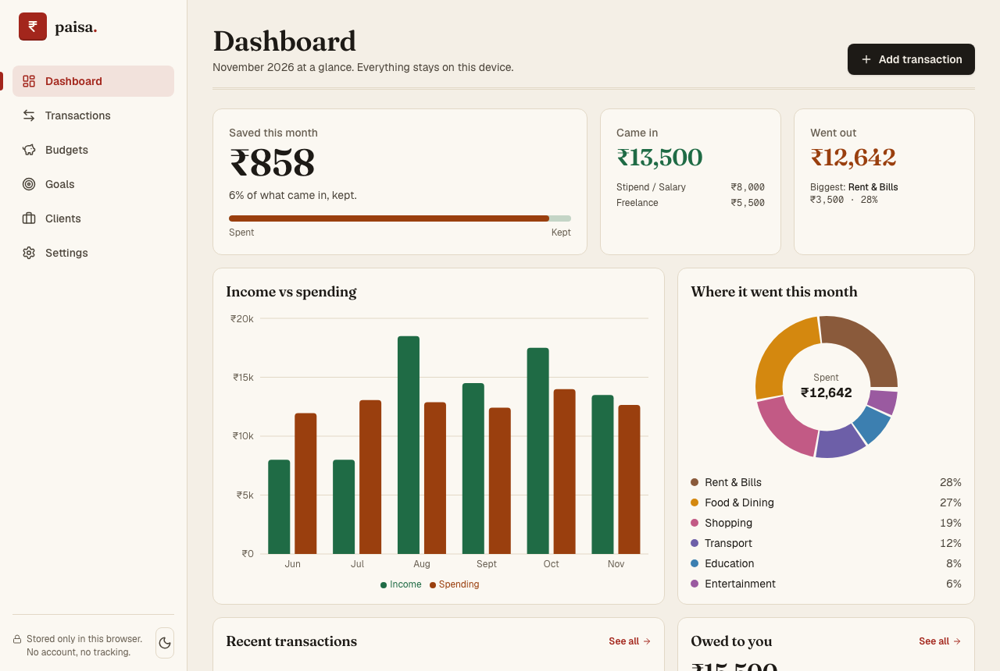
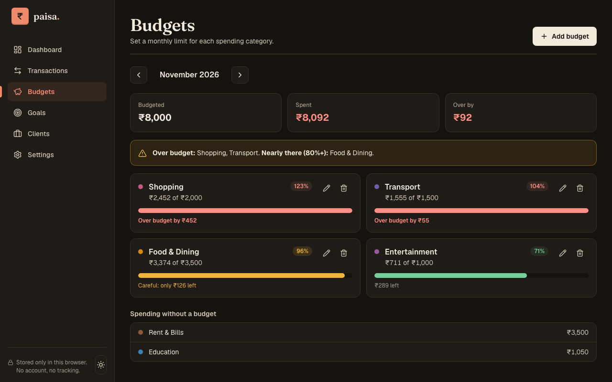
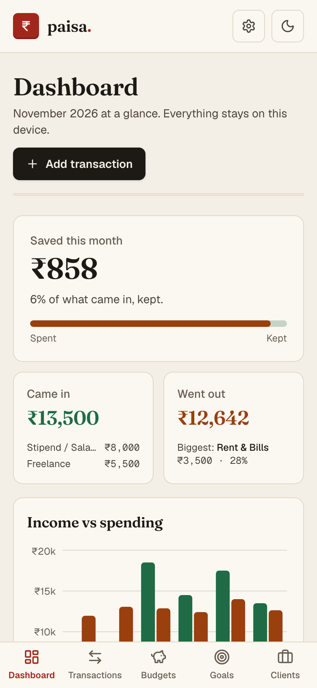
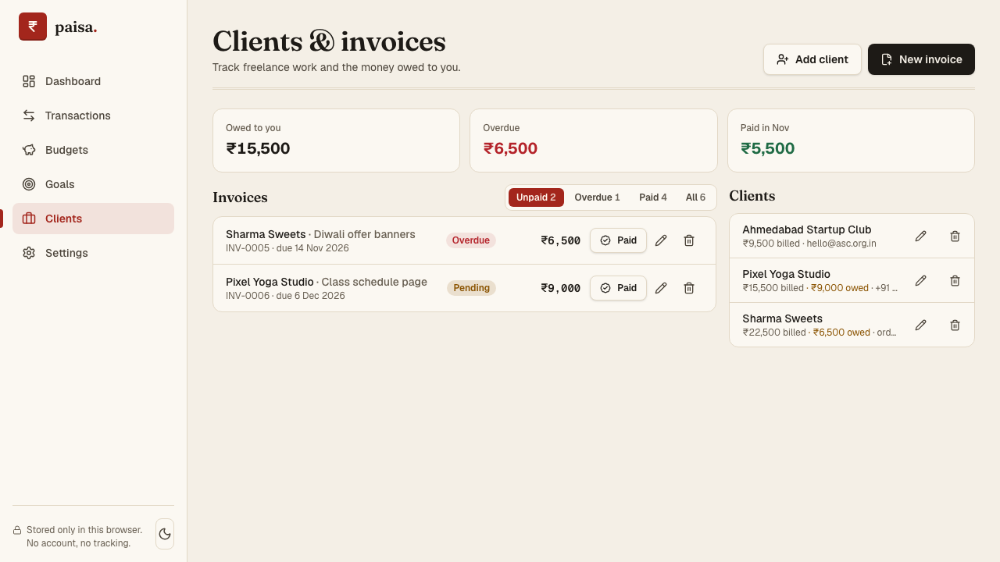
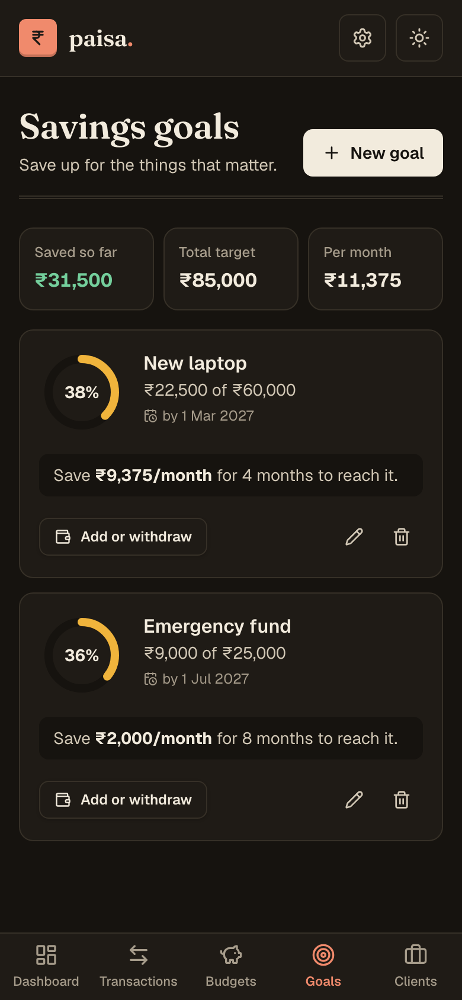

# Paisa

A private personal-finance dashboard for students and freelancers in India. Track spending, monthly budgets and savings goals in ₹. All data stays in your browser (IndexedDB): no sign-up, no backend, no API keys, nothing paid.

<p>
  
</p>

| Dark mode | Phone |
|---|---|
|  |  |
|  |  |

## Run it

```bash
npm install
npm run dev
```

Then open http://localhost:3000. Six months of demo data load on first visit, so every screen has something to show.

Production build: `npm run build && npm start`.

## Features

**Dashboard**
- Income, spending, savings and savings rate for the current month
- Income vs spending bar chart for the last six months
- Spending-by-category donut for this month
- Recent transactions, budget progress and goals in progress

**Transactions**
- Add, edit and delete income or expenses (React Hook Form + Zod validation)
- Filter by type, category, payment method (UPI, card, cash, bank) and date range
- Search notes and categories, sort by date or amount, paginated list
- Keyboard shortcuts: `N` adds a transaction, `/` jumps to search

**Budgets**
- A monthly limit per spending category, with a progress bar
- Warning at 80%, alert when a budget is exceeded
- Switch months, copy last month's budgets, see spending that has no budget

**Savings goals**
- Target amount and date, progress ring, and how much to save each month
- Add money to a goal or withdraw from it; reached and overdue states

**Clients & invoices**
- Add clients, raise numbered invoices with issue and due dates
- Pending, overdue and paid states; totals for money owed, overdue and paid this month
- Marking an invoice paid adds the income to Transactions; marking it unpaid removes it

**Settings**
- Light, dark or system theme; Indian or international digit grouping, paise or rounded
- Add, rename, recolour and delete categories (deleting moves transactions to another category)
- Export transactions to CSV and import from CSV
- Load demo data or reset everything

## Tests

```bash
npm test            # unit tests (Vitest): money calculations, invoices, CSV
npm run test:e2e    # end-to-end tests (Playwright)
```

The end-to-end suite covers the main flows (transactions, budgets, goals, invoices, CSV export, currency format, keyboard use). It also loads every page at 375, 768 and 1280px to check for sideways scrolling and placeholders, and runs axe-core WCAG 2 AA checks in light and dark mode. The first run needs `npx playwright install chromium`.

GitHub Actions runs lint, type-check, unit tests, the production build and the end-to-end suite on every push.

## CSV format

```csv
date,type,amount,category,method,note
2026-11-02,expense,1200,Books,card,"Notes, semester 3"
05/11/2026,income,2500,Freelance,upi,Logo design
```

- `date` is `YYYY-MM-DD` or `DD/MM/YYYY`; `type` is `income` or `expense`
- Unknown categories are created on import; `method` defaults to `upi`
- Invalid rows are skipped and reported with their line number

## Deploy (free)

It's a static Next.js app with no server code or environment variables, so any static host works. On [Vercel](https://vercel.com): import the GitHub repo and keep the defaults. Each visitor's data still stays in their own browser.

## Design

The look is based on the *bahi-khata*, the red cloth account book Indian shops keep: warm paper, ink-dark text, a vermilion rupee mark and marigold for progress. Headings use the Fraunces serif, and amounts in lists use a monospace face, like a column of figures. Green always means money in and red always means a problem, so category colours avoid both. Motion is small: pages ease in, progress bars grow, and the month's savings count up. All of it switches off when the device asks for reduced motion.

## Tech

- Next.js 15 (App Router) + TypeScript
- Tailwind CSS 4, light and dark themes
- Dexie.js on IndexedDB for local storage
- Recharts, React Hook Form + Zod, lucide-react
- Vitest, Playwright, axe-core

## Project structure

```
src/
  app/          pages: dashboard, transactions, budgets, goals, clients, settings
  components/   ui.tsx (Button, Modal, Field…), layout/, charts, forms
  hooks/        live queries for categories and transactions
  lib/          db.ts (Dexie), calculations.ts, csv.ts, theme.ts, format.ts, demo-data.ts
  types/        shared TypeScript types
tests/
  unit/         Vitest
  e2e/          Playwright flows, layout and accessibility checks
scripts/        screenshots.mjs regenerates the README images
```

## Roadmap

- [x] Project setup, responsive layout, dark mode, local database and demo data
- [x] Transactions: add/edit/delete, filters, search, sort, pagination
- [x] Budgets with warnings and alerts
- [x] Savings goals
- [x] Settings: theme, categories, CSV import/export, reset
- [x] Dashboard charts
- [ ] Recurring transactions (rent, subscriptions, SIPs)
- [x] Freelance clients and invoices
- [x] Tests (Vitest + Playwright), CI and an accessibility pass
- [ ] Live demo on Vercel
